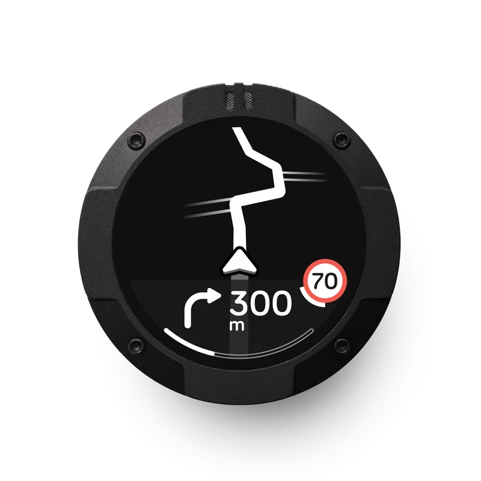
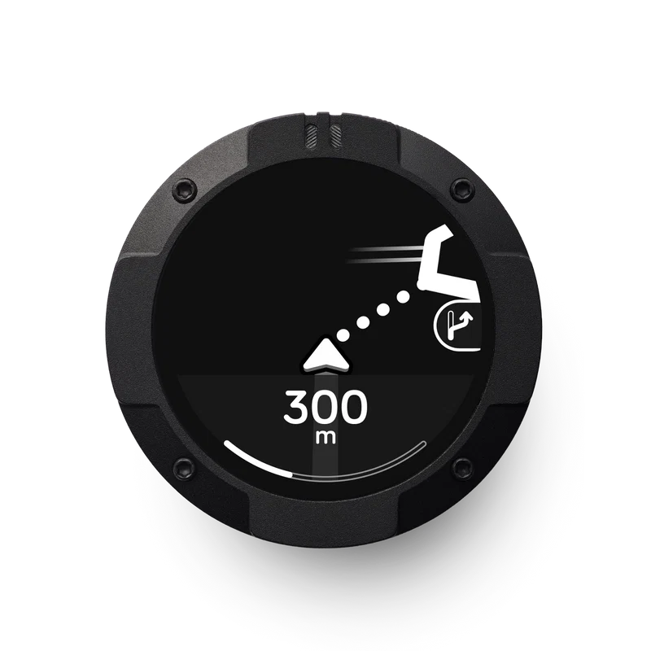
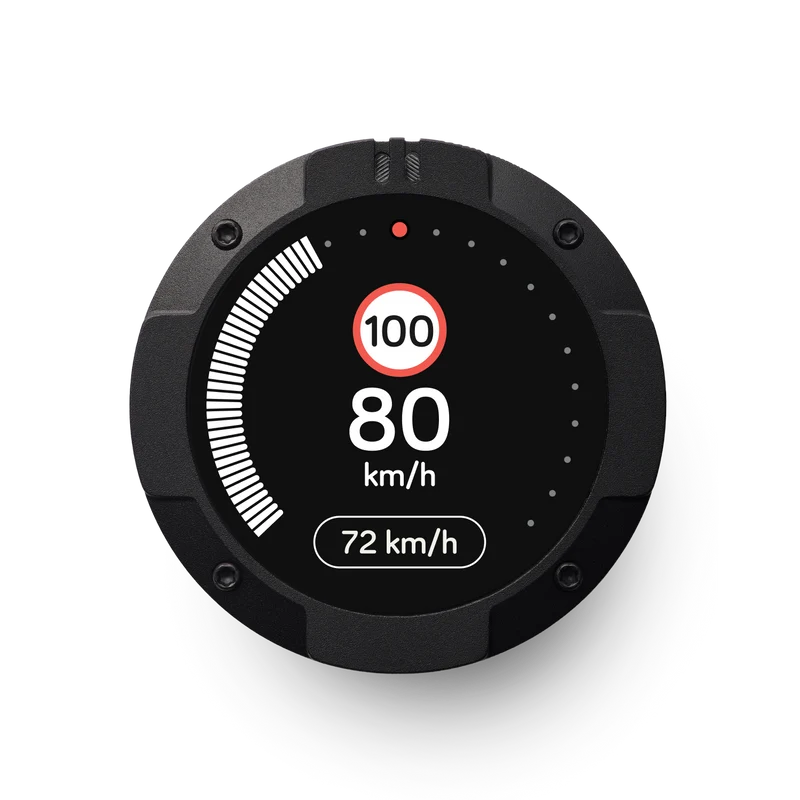
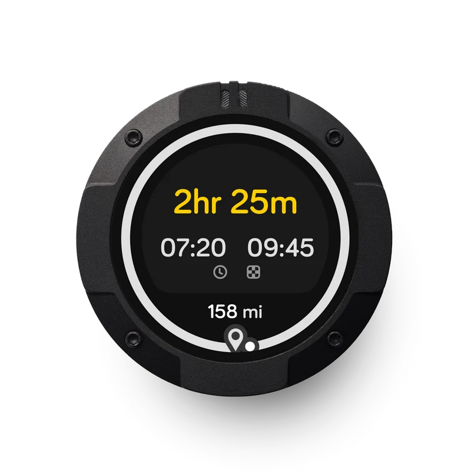
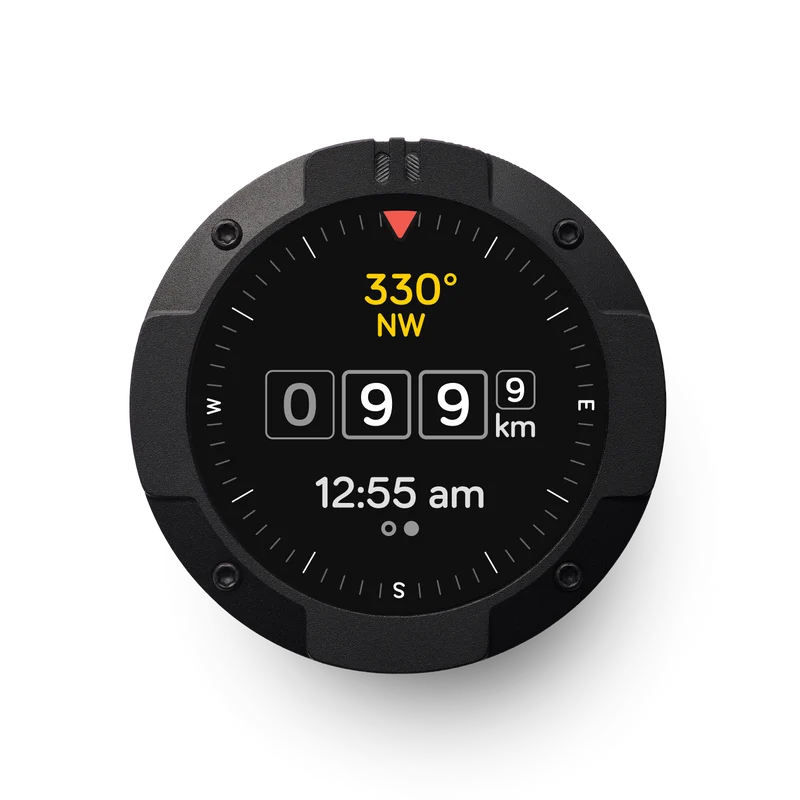
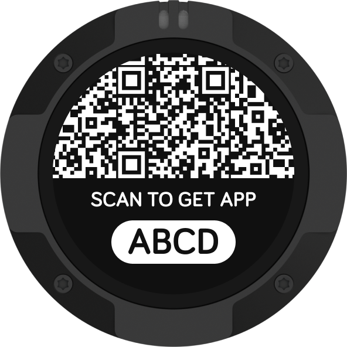
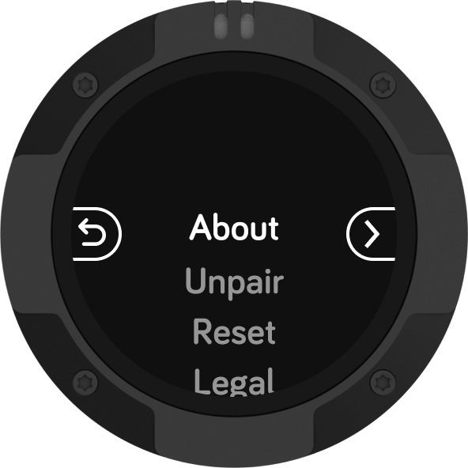
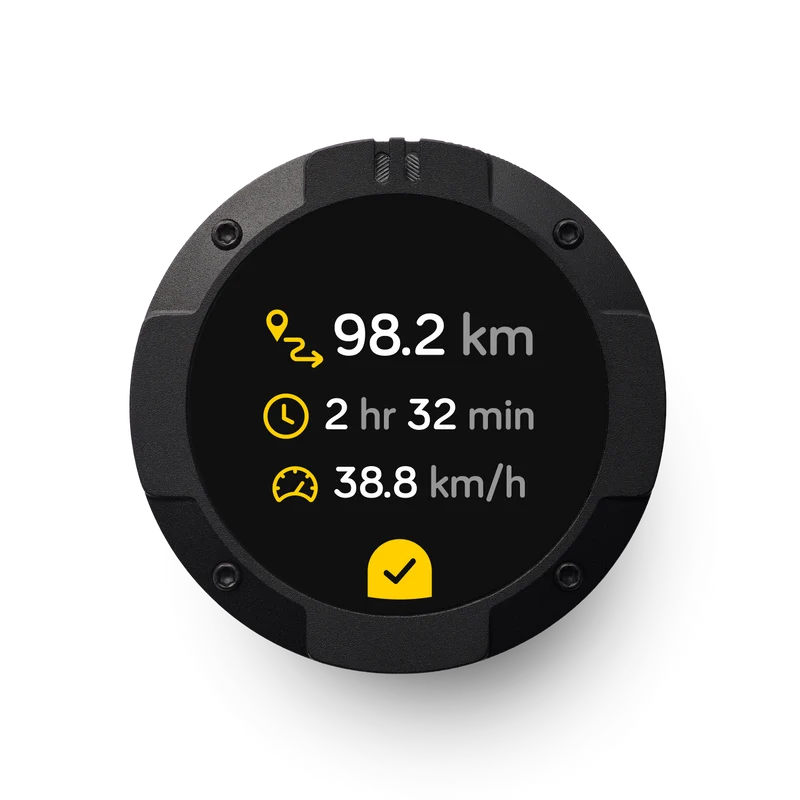
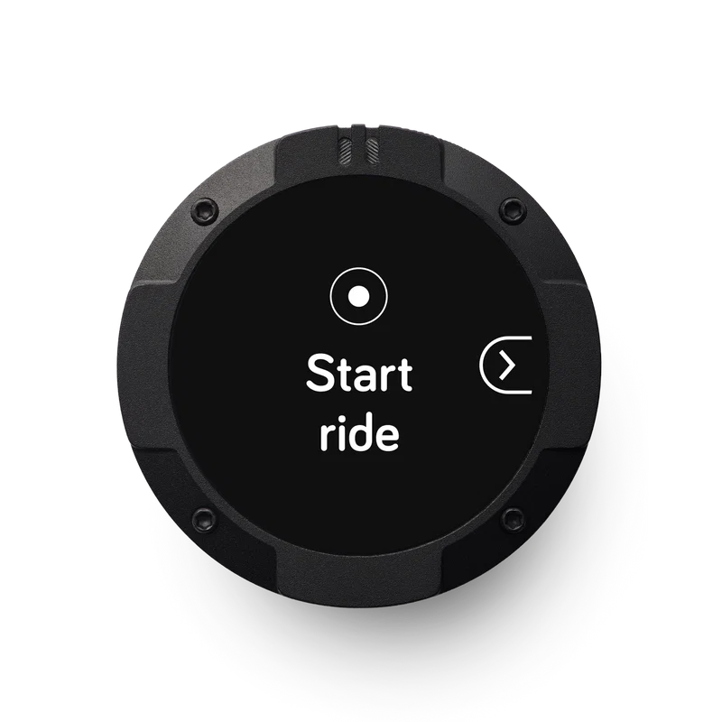
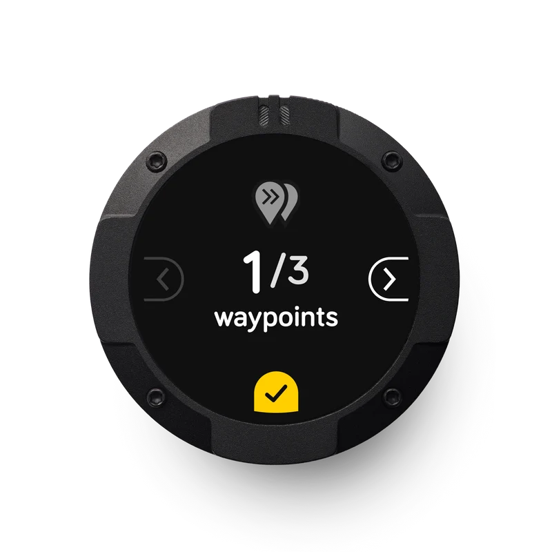

# MotoWear OS 🏍️⌚

[](LICENSE)
[](https://developer.android.com/wear)
[](https://kotlinlang.org/)
[](https://developer.android.com/training/wearables/compose)
[](https://m3.material.io)

**MotoWear OS** transforms any circular Wear OS smartwatch into a pixel-for-pixel, feature-complete functional replica of the **Beeline Moto 2** motorcycle navigation computer.

Whether worn on the wrist or mounted to handlebars, MotoWear OS delivers sunlight-readable turn-by-turn navigation, live speed and speed limits, compass tracking, detour rerouting, and direct Bluetooth pairing with the official Beeline mobile app.

---

## 📱 Screen Showcase

| Turn-by-Turn | Fast Rerouting | Speedometer | Journey Progress |
| :---: | :---: | :---: | :---: |
|  |  |  |  |

| Compass & Tracking | QR Onboarding | Device Settings | Ride Summary |
| :---: | :---: | :---: | :---: |
|  |  |  |  |

| Quick Start | Waypoint Skipping |
| :---: | :---: |
|  |  |

---

## 🌟 Key Features

* **11 Authentic Beeline Moto 2 Modes**:
  1. `QUICK_START` — Instant zero-setup ride launcher.
  2. `TURN_BY_TURN` — Primary 2D vector mini-map, vector maneuvers, roundabout exits, distance to turn, live speed badge, and ETA.
  3. `FAST_REROUTING` — Automatic off-route detection with 4-dot detour breadcrumbs and rejoin glyphs.
  4. `SPEEDO` — High-visibility speedometer, average speed, and speed limit warning ring.
  5. `JOURNEY_PROGRESS` — Remaining distance, time countdown, and circular completion progress arc.
  6. `JOURNEY_TRACKING` — 360° rotating compass ring, digital heading degrees, elapsed time, total odometer, and clock.
  7. `WAYPOINT_SKIPPING` — Multi-stop waypoint management with confirmation dome.
  8. `JOURNEY_SUMMARY` — Post-ride statistics review (distance, time, average speed).
  9. `DEVICE_SETTINGS` — Vertical rotary wheel settings menu (`About`, `Unpair`, `Reset`, `Legal`) with Beeline edge D-buttons.
  10. `QR_ONBOARDING` — ISO/IEC 18004 QR code matrix pairing screen with 4-character device ID pill (`8046`).
  11. `DEBUG_TELEMETRY` — Real-time telemetry inspector displaying packet frequency, latency, COG heading, and vector node counts.
* **Direct BLE GATT Hardware Peripheral Emulation**:
  * Emulates the official Beeline Moto II BLE profile (`C5D70001` service).
  * Direct pairing with the official **Beeline mobile app** (`co.beeline` on Android and iOS) without requiring an intermediary host.
* **Dual Routing Ingest Paths (Companion Host)**:
  * **Path 1: Native GPX Engine** — Parse `.gpx` files with 2D vector projection and turn inference.
  * **Path 2: Notification Listener Bridge** — Intercept live navigation streams from Official Beeline, Google Maps, and OsmAnd.
* **Material 3 Expressive Companion Phone App**:
  * Modern, expressive Android companion UI for route ingestion, simulation controls, and telemetry streaming.
* **Glove & Wet Weather Friendly**:
  * Capacitive Touch Lock mode (long-press top stem button for 1.5s) to prevent false triggers in rain or road spray.
  * Hardware button (`STEM_1`, `STEM_2`) and rotary crown state machine.
* **Battery & Screen Protection**:
  * Dynamic Distance Wake: Automatically dims and switches to hollow vector wireframes during straightaways over 400m, restoring full brightness 5s before maneuvers.
  * Continuous $\pm 4\text{px}$ OLED burn-in pixel shift.

---

## 🏗️ Architecture & Modules

```
MotoWear OS
├── :shared-proto      # Protobuf contract (telemetry.proto) & zero-allocation domain mapping
├── :wear              # Wear OS client app (Jetpack Compose Canvas UI, BLE GATT peripheral)
└── :phone             # Android phone companion app (M3 Expressive UI, GPX parser, BLE host)
```

* **`:shared-proto`**: Shared binary Protobuf schema (`telemetry.proto`) for efficient 10Hz low-overhead communication between phone host and watch client.
* **`:wear`**: Circular AMOLED UI rendered using Jetpack Compose Canvas, hardware rotary crown/button handler, BLE peripheral server, and built-in 60fps mock telemetry fallback simulator.
* **`:phone`**: Dual-ingest routing engine, native GPX 1.1 parser, GPS location tracker, notification listener bridge, and TTS helmet intercom router.

---

## 📚 Technical Documentation

In-depth technical specifications and architectural documentation are available in the [`docs/`](docs/) directory:

* 📐 **[System Architecture](docs/ARCHITECTURE.md)** — High-level architecture, module boundaries, data flows, and threading model.
* 📡 **[BLE GATT Specification](docs/BLE_GATT_SPEC.md)** — Reverse-engineered Beeline Moto II BLE GATT services, UUIDs, opcodes, and notifications.
* 📜 **[Protobuf Wire Protocol](docs/PROTOBUF_PROTOCOL.md)** — Schema definitions, coordinate normalization, and 10Hz streaming bandwidth optimization.
* 🖥️ **[Screen Modes Catalog](docs/SCREEN_MODES.md)** — Complete catalog and layout breakdown for all 11 screen modes.
* 🌉 **[Navigation Bridge Specification](docs/NAVIGATION_BRIDGE.md)** — Notification scraping heuristics, regex rules, and synthetic vector generation.
* 🛠️ **[Developer & Contributor Guide](docs/DEVELOPMENT_GUIDE.md)** — Environment setup (JDK 17), build targets, emulator and watch deployment, and testing.

---

## 🚀 Getting Started

### Prerequisites

* **Android Studio** (Ladybug / 2024.2.1+ recommended)
* **OpenJDK 17** (`export JAVA_HOME=...`)
* **Android SDK** API 34+
* **Wear OS Device or Circular Emulator**: Wear OS 4.0+ (API 33+)
* **Phone Device or Emulator**: Android 11+ (API 30+)

### Building the Project

```bash
# Build all APKs
./gradlew assembleDebug

# Run all unit tests across modules
./gradlew test
```

### Running the Apps

1. **Wear OS App**: Deploy `:wear` module to your Wear OS smartwatch or circular emulator. If no phone is connected, it automatically runs an internal 60fps simulation.
2. **Companion Phone App**: Deploy `:phone` module to your Android smartphone or emulator to stream live GPS routes or bridge external navigation notifications.
3. **Official Beeline Pairing**: Open the official Beeline app on your phone, navigate to *Devices* $\to$ *Pair Device*, and connect directly to `"Beeline Moto II"`.

---

## 🤝 Contributing

Contributions are welcome! Please see [CONTRIBUTING.md](CONTRIBUTING.md) for details on code style, branch guidelines, and submission workflows.

---

## 📄 License

This project is licensed under the MIT License - see the [LICENSE](LICENSE) file for details.
