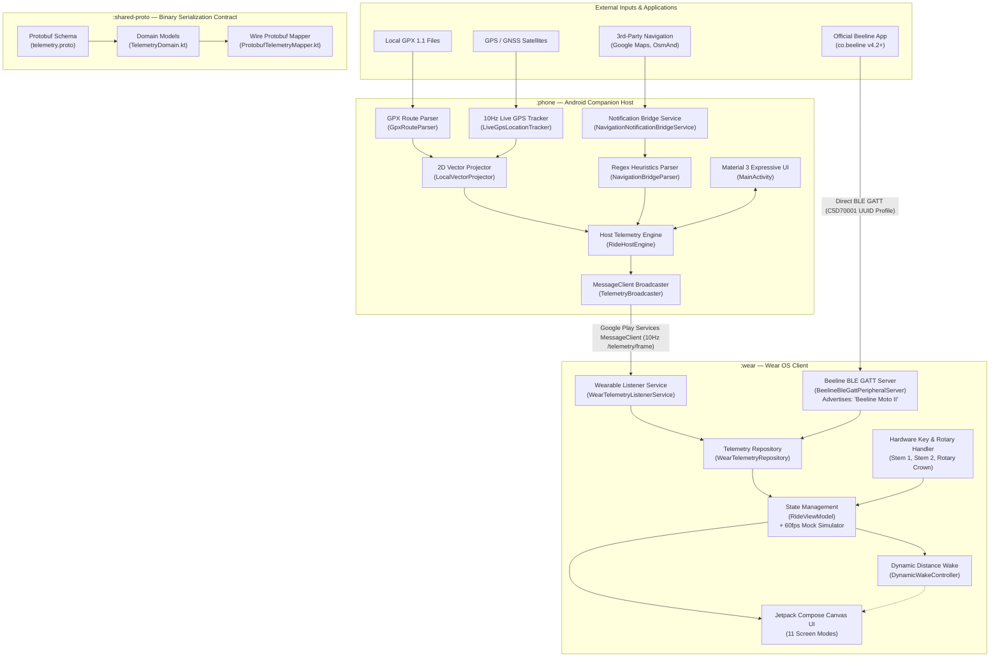

# MotoWear OS Architecture & System Design 🏍️📐

MotoWear OS is an open-source navigation system that transforms any circular Wear OS smartwatch into a pixel-for-pixel, feature-complete functional replica of the **Beeline Moto 2** motorcycle navigation computer.

This document describes the high-level architecture, module boundaries, inter-process communication (IPC), BLE peripheral emulation, and hardware state machines across the codebase.

---

## 1. System Topology & Component Diagram

---

## 2. Module Responsibilities & Boundaries

The codebase is structured into three modular Gradle subprojects:

### `:shared-proto`
* **Purpose**: Single source of truth for the binary data protocol between the Android companion app and the Wear OS watch.
* **Key Components**:
  * [`telemetry.proto`](file:///Users/abin/workspace/projects/motonavi/shared-proto/src/main/proto/telemetry.proto): Protocol Buffers schema declaring `RideTelemetryFrame`, `PolylineSegment`, `Point2D`, `ActiveScreenMode`, and `ManeuverType`.
  * [`TelemetryDomain.kt`](file:///Users/abin/workspace/projects/motonavi/shared-proto/src/main/java/com/motowear/telemetry/TelemetryDomain.kt): Idiomatic Kotlin immutable data classes (`TelemetryFrameState`, `RoutePolyline`, `Vec2`, `ScreenMode`, `ManeuverKind`).
  * [`ProtobufTelemetryMapper.kt`](file:///Users/abin/workspace/projects/motonavi/shared-proto/src/main/java/com/motowear/telemetry/ProtobufTelemetryMapper.kt): Zero-allocation bi-directional serialisation between Protobuf generated classes and Kotlin domain models.

### `:wear`
* **Purpose**: Low-latency, sunlight-readable circular smartwatch application.
* **Key Components**:
  * [`WearMainActivity.kt`](file:///Users/abin/workspace/projects/motonavi/wear/src/main/java/com/motowear/wear/WearMainActivity.kt): Activity entry point managing ambient lifecycle, Bluetooth permissions, stem button listeners (`KEYCODE_STEM_1`, `KEYCODE_STEM_2`), and Cold Boot SLAs.
  * [`BeelineBleGattPeripheralServer.kt`](file:///Users/abin/workspace/projects/motonavi/wear/src/main/java/com/motowear/wear/ble/BeelineBleGattPeripheralServer.kt): Reverse-engineered BLE peripheral emulation supporting direct connection with the official Beeline mobile app without any intermediary phone app.
  * [`RideViewModel.kt`](file:///Users/abin/workspace/projects/motonavi/wear/src/main/java/com/motowear/wear/state/RideViewModel.kt): Reactive StateFlow repository binding, hardware button dispatcher, screen mode transitions, and fallback 60fps mock telemetry generator.
  * [`DynamicWakeController.kt`](file:///Users/abin/workspace/projects/motonavi/wear/src/main/java/com/motowear/wear/power/DynamicWakeController.kt): Dynamic Distance Wake controller that activates high-contrast hollow ambient mode during straightaways (`> 400m`) and restores full brightness `5s` prior to maneuvers.
  * `ui/screens/`: 11 dedicated Jetpack Compose Canvas renderers replicating Beeline Moto 2 screens pixel-for-pixel.

### `:phone`
* **Purpose**: Companion host engine running on rider's Android smartphone mounted or stowed in pocket.
* **Key Components**:
  * [`MainActivity.kt`](file:///Users/abin/workspace/projects/motonavi/phone/src/main/java/com/motowear/phone/MainActivity.kt): Modern Material 3 Expressive UI for route selection, mode toggling, simulation controls, and permission onboarding.
  * [`RideForegroundService.kt`](file:///Users/abin/workspace/projects/motonavi/phone/src/main/java/com/motowear/phone/service/RideForegroundService.kt): Foreground Service managing persistent CPU wake lock, location updates, and inter-app notification listeners.
  * [`GpxRouteParser.kt`](file:///Users/abin/workspace/projects/motonavi/phone/src/main/java/com/motowear/phone/gpx/GpxRouteParser.kt): Native GPX 1.1 XML pull-parser with turn-maneuver inference and waypoint indexing.
  * [`LocalVectorProjector.kt`](file:///Users/abin/workspace/projects/motonavi/phone/src/main/java/com/motowear/phone/projection/LocalVectorProjector.kt): Projects WGS-84 coordinates into normalized $[-1.0, 1.0]$ rider heading-up coordinate space.
  * [`NavigationNotificationBridgeService.kt`](file:///Users/abin/workspace/projects/motonavi/phone/src/main/java/com/motowear/phone/bridge/NavigationNotificationBridgeService.kt) & [`NavigationBridgeParser.kt`](file:///Users/abin/workspace/projects/motonavi/phone/src/main/java/com/motowear/phone/bridge/NavigationBridgeParser.kt): Real-time notification scraper and regex classifier supporting Beeline, Google Maps, and OsmAnd.
  * [`TelemetryBroadcaster.kt`](file:///Users/abin/workspace/projects/motonavi/phone/src/main/java/com/motowear/phone/TelemetryBroadcaster.kt): Encodes and streams 10Hz Protobuf packets over the Google Play Services Wearable `MessageClient`.

---

## 3. Dual Ingestion Pipelines

MotoWear OS supports two completely independent pathways to receive and display navigation data:

### Pathway 1: Companion Host Pipeline (GPX & Notification Bridge)
1. The Companion Phone App loads a `.gpx` file or intercepts navigation notifications from Google Maps or OsmAnd.
2. The phone service samples live GPS location via `FusedLocationProviderClient` at 10Hz.
3. Coordinates are transformed into local normalized heading-up vectors.
4. The frame is serialized to Protobuf binary format and sent over Google Play Services `MessageClient` to the watch.
5. The watch app receives the bytes in `WearTelemetryListenerService`, updates `WearTelemetryRepository`, and renders to Canvas.

### Pathway 2: Direct BLE GATT Peripheral Emulation
1. The Wear OS watch launches `BeelineBleGattPeripheralServer` and starts BLE advertising as `Beeline Moto II`.
2. The official Beeline mobile app (`co.beeline`) scans for Beeline devices, discovers the watch, and pairs with it natively.
3. The Beeline mobile app writes raw navigation frames directly to characteristic `C5D70002-C45D-4F12-8693-7EF838E96446`.
4. The GATT server parses opcodes for maneuvers, speeds, distance, and vectors, routing them directly into `WearTelemetryRepository`.
5. When the rider presses physical watch buttons, notifications are dispatched to characteristic `C5D70003` to inform the Beeline app of button interactions.

---

## 4. Hardware Interaction Model

Smartwatch physical controls are mapped directly to Beeline Moto 2 hardware behaviors:

| Input Event | Watch Hardware Mapping | Action / State Transition |
| :--- | :--- | :--- |
| **Top Short Press / Wheel CW** | `KEYCODE_STEM_1` / Rotary Crown CW | Next screen mode in active carousel cycle |
| **Wheel CCW** | Rotary Crown CCW | Previous screen mode in active carousel cycle |
| **Top Long Press (> 1.5s)** | `KEYCODE_STEM_1` held for $\ge 1500\text{ ms}$ | Toggle Capacitive Touch Lock (wet weather / glove lock) |
| **Bottom Action Press** | `KEYCODE_STEM_2` / `KEYCODE_STEM_PRIMARY` | Mode-specific action (e.g. skip waypoint, start ride, dismiss) |

---

## 5. Performance SLAs & Power Constraints

* **Cold Boot Time**: $< 1.2\text{ seconds}$ from process start to interactive `QUICK_START` screen (validated via `reportFullyDrawn()`).
* **Frame Rate**: Constant $60\text{ fps}$ Jetpack Compose Canvas rendering with zero UI thread disk I/O.
* **Latency**: $< 100\text{ ms}$ end-to-end packet delivery from phone GPS tick to watch display update.
* **OLED Protection**: Continuous ambient pixel shifting ($\pm 4\text{ px}$) to prevent static burn-in.
* **Battery Consumption**: Dynamic Distance Wake maintains low-power ambient mode during straight segments over $400\text{ m}$.
