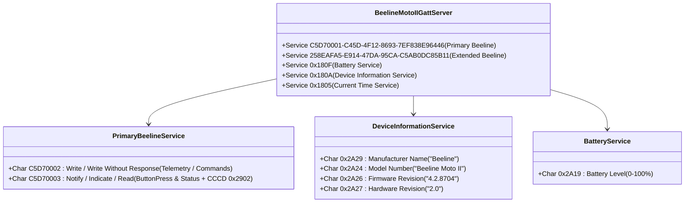

# Beeline Moto II BLE GATT Emulation Specification 📡🏍️

MotoWear OS implements a hardware-accurate Bluetooth Low Energy (BLE) Generic Attribute Profile (GATT) peripheral server ([`BeelineBleGattPeripheralServer.kt`](file:///Users/abin/workspace/projects/motonavi/wear/src/main/java/com/motowear/wear/ble/BeelineBleGattPeripheralServer.kt)).

This allows any Wear OS smartwatch running MotoWear OS to advertise and function as a physical **Beeline Moto 2** device, directly pairing with the official Beeline mobile app (`co.beeline` v4.2+ on Android and iOS).

---

## 1. BLE Advertising & Discovery Profile

To ensure immediate discovery by the official Beeline app during Bluetooth device scanning, the peripheral advertises with:

* **Advertising Settings**:
  * `AdvertiseSettings.ADVERTISE_MODE_LOW_LATENCY`
  * `AdvertiseSettings.ADVERTISE_TX_POWER_HIGH`
  * Connectable: `true`, Timeout: `0` (continuous)
* **Primary Adv Data (31-byte limit compliant)**:
  * Service UUID: `C5D70001-C45D-4F12-8693-7EF838E96446` (21 bytes)
  * `includeDeviceName`: `false` (to prevent packet truncation)
* **Scan Response Data**:
  * Device Local Name: `"Beeline Moto II"` (`includeDeviceName = true`)

---

## 2. GATT Services & Characteristics Map



### Table of Service & Characteristic UUIDs

| Service / Characteristic | UUID | Properties | Purpose |
| :--- | :--- | :--- | :--- |
| **Primary Beeline Service** | `c5d70001-c45d-4f12-8693-7ef838e96446` | Primary Service | Official Beeline Moto II control service |
| ↳ Telemetry Write Char | `c5d70002-c45d-4f12-8693-7ef838e96446` | `WRITE`, `WRITE_NO_RESPONSE` | Inbound navigation stream from Beeline app |
| ↳ Button / Event Notify | `c5d70003-c45d-4f12-8693-7ef838e96446` | `NOTIFY`, `INDICATE`, `READ` | Outbound user button clicks to Beeline app |
| ↳ CCCD Descriptor | `00002902-0000-1000-8000-00805f9b34fb` | `READ`, `WRITE` | Client Characteristic Configuration (subscription) |
| **Extended Beeline Service** | `258eafa5-e914-47da-95ca-c5ab0dc85b11` | Primary Service | Telemetry and route chunk buffer |
| ↳ Ext Char 1 | `5ed8c8fd-b47c-4f04-a53f-aef2176f334c` | `WRITE`, `READ`, `NOTIFY` | Polyline vector data chunks |
| ↳ Ext Char 2 | `95ed6082-b8e9-46e8-a73f-ff56f00f5d9d` | `WRITE`, `READ`, `NOTIFY` | Waypoint list sync |
| ↳ Ext Char 3 | `d861b25a-1edf-11eb-adc1-0242ac120002` | `WRITE`, `READ`, `NOTIFY` | Device settings sync |
| **Battery Service** | `0000180f-0000-1000-8000-00805f9b34fb` | Primary Service | Standard Bluetooth SIG Battery Service |
| ↳ Battery Level | `00002a19-0000-1000-8000-00805f9b34fb` | `READ`, `NOTIFY` | Real Wear OS battery level (0–100%) |
| **Device Info Service** | `0000180a-0000-1000-8000-00805f9b34fb` | Primary Service | Standard Bluetooth SIG Device Info Service |
| ↳ Manufacturer | `00002a29-0000-1000-8000-00805f9b34fb` | `READ` | Returns ASCII `"Beeline"` |
| ↳ Model Number | `00002a24-0000-1000-8000-00805f9b34fb` | `READ` | Returns ASCII `"Beeline Moto II"` |
| ↳ Firmware Rev | `00002a26-0000-1000-8000-00805f9b34fb` | `READ` | Returns ASCII `"4.2.8704"` |
| ↳ Hardware Rev | `00002a27-0000-1000-8000-00805f9b34fb` | `READ` | Returns ASCII `"2.0"` |

---

## 3. Inbound Wire Telemetry Payload Formats

Characteristics `C5D70002` and extended write characteristics accept three complementary encoding formats:

### Format A: Compact 10-Byte Low-Overhead Frame (`0xB2` Header)
Designed for ultra-low latency 10Hz updates over constrained BLE MTUs:

```
+--------+--------+--------+--------+--------+--------+--------+--------+--------+--------+
| Byte 0 | Byte 1 | Byte 2 | Byte 3 | Byte 4 | Byte 5 | Byte 6 | Byte 7 | Byte 8 | Byte 9 |
|  0xB2  | Maneuv | RndExt | DistLo | DistHi | Speed  | SpdLim | HeadLo | HeadHi | Flags  |
+--------+--------+--------+--------+--------+--------+--------+--------+--------+--------+
```

* **Byte 0**: Magic Byte `0xB2` (178 decimal)
* **Byte 1**: Maneuver Kind Index (0=Straight, 1=Left, 2=Right, 3=Slight Left, 4=Slight Right, 5=Sharp Left, 6=Sharp Right, 7=U-turn, 8=Roundabout Left, 9=Roundabout Right)
* **Byte 2**: Roundabout Exit Number ($0-12$)
* **Bytes 3–4**: Distance to next turn in meters (uint16 little-endian)
* **Byte 5**: Current Speed in km/h (uint8)
* **Byte 6**: Speed Limit in km/h (uint8, default 70)
* **Bytes 7–8**: Course Over Ground Heading ($0–359^\circ$, uint16 little-endian)
* **Byte 9**: Bitmask Flags:
  * Bit 0: `isOffRoute` / fast rerouting active ($1 = \text{true}$)
  * Bit 1: `imperialUnits` ($1 = \text{mph/miles}$)
  * Bit 2: `hasArrived` ($1 = \text{destination reached}$)

### Format B: Official Beeline Wire-Protobuf TLV Varint
When the official `co.beeline` app communicates using its internal protobuf command structures:
* Field 1: Command / Screen Mode (`0 = Quick Start`, `1 = Turn-by-Turn`, `2 = Reroute`, `3 = Speedo`)
* Field 2: Maneuver Type index & turn direction
* Field 3: Distance to next turn in meters
* Field 4: Current speed in km/h
* Field 5: Speed limit in km/h
* Field 6: Course heading in degrees ($0-359$)
* Field 7: Roundabout exit number

### Format C: Full MotoWear `RideTelemetryFrame` Protobuf
When communicating with the MotoWear companion phone app over Bluetooth or Wearable Data Layer, full binary Protobuf messages containing 2D map polyline vectors and breadcrumb coordinates are decoded.

---

## 4. Outbound Button Press Notifications

When the rider presses physical watch buttons (or rotates the crown), `BeelineBleGattPeripheralServer.notifyUserActionButtonPress(buttonId)` dispatches a notification packet to subscribed centrals on `C5D70003`:

* **Wire Encoding**: `[0x08, buttonId & 0x7F]` (Protobuf field 1 Varint for `UserAction.ButtonPress`)
* **Button IDs**:
  * `1`: Top Stem Button Short Press / Next Screen
  * `2`: Bottom Stem Button / Confirm / Skip Waypoint
  * `3`: Top Stem Button Long Press (>1.5s) / Touch Lock Toggle
