# Navigation Notification Bridge Specification 🌉📱

The MotoWear OS Navigation Notification Bridge ([`NavigationNotificationBridgeService.kt`](file:///Users/abin/workspace/projects/motonavi/phone/src/main/java/com/motowear/phone/bridge/NavigationNotificationBridgeService.kt) and [`NavigationBridgeParser.kt`](file:///Users/abin/workspace/projects/motonavi/phone/src/main/java/com/motowear/phone/bridge/NavigationBridgeParser.kt)) enables real-time scraping and parsing of navigation guidance emitted by external Android navigation apps.

This allows riders to use **Google Maps**, **OsmAnd**, or the **Official Beeline App** on their Android phone while streaming authentic Beeline Moto 2 turn-by-turn guidance, vector maps, and metrics directly to their smartwatch.

---

## 1. Architecture & Pipeline

```mermaid
flowchart LR
    subgraph HostPhone["Android Companion Phone"]
        ExtApp["Navigation App\n(Google Maps, OsmAnd, Beeline)"]
        NotifListener["NotificationListenerService\n(NavigationNotificationBridgeService)"]
        BridgeParser["Heuristics & Regex Parser\n(NavigationBridgeParser)"]
        SyntheticEngine["2D Vector Synthesizer\n(synthesize2DTurnVectors)"]
        HostEngine["Host Telemetry Engine\n(RideHostEngine)"]
    end

    subgraph WearWatch["Wear OS Smartwatch"]
        WatchUI["Jetpack Compose Canvas\n(TurnByTurnAndRerouteScreen)"]
    end

    ExtApp -->|"Android Notification Stream"| NotifListener
    NotifListener -->|"Raw Title / Text / SubText"| BridgeParser
    BridgeParser -->|"Maneuver & Distance"| SyntheticEngine
    SyntheticEngine -->|"Heading-Up Polylines"| HostEngine
    HostEngine -->|"10Hz Protobuf MessageClient"| WatchUI
```



---

## 2. Supported Navigation Packages

| App Name | Android Package ID | Verification Status |
| :--- | :--- | :---: |
| **Beeline Official App** | `co.beeline`, `com.beeline` | Fully Verified (v4.2.8704) |
| **Google Maps** | `com.google.android.apps.maps` | Fully Verified |
| **OsmAnd / OsmAnd+** | `net.osmand`, `net.osmand.plus` | Fully Verified |

---

## 3. Parsing Heuristics & Regular Expressions

### Distance Extraction (`DISTANCE_REGEX`)
```regex
(\d+(?:[.,]\d+)?)\s*(km|m|mi|yd|ft)\b
```
Supports both decimal points and commas (e.g. `1.2 km`, `300 m`, `0.5 mi`, `500 ft`). Units are automatically converted to standard integer meters:
* `km` $\to \text{value} \times 1000$
* `m` $\to \text{value}$
* `mi` $\to \text{value} \times 1609.34$
* `yd` $\to \text{value} \times 0.9144$
* `ft` $\to \text{value} \times 0.3048$

### Roundabout Exit Extraction (`EXIT_REGEX`)
```regex
exit\s*#?\s*(\d+)|(\d+)(?:st|nd|rd|th)\s+exit
```
Extracts roundabout exit indices such as `"take exit 2"` or `"take the 3rd exit"`.

### ETA & Duration Extraction
* **Duration Regex**: `(?:(\d+)\s*h(?:r|rs|our|ours)?\s*)?(\d+)\s*m(?:in|ins|inute|inutes)?\b`
* **ETA Clock Regex**: `\b(\d{1,2}:\d{2}(?:\s*[ap]m)?)\b`

### Maneuver Classification
The parser classifies maneuvers into `ManeuverKind` based on text tokens:
* `"u-turn"`, `"uturn"`, `"make a u"` $\to$ `UTURN`
* `"roundabout"`, `"rotary"` + `"left"` $\to$ `ROUNDABOUT_LEFT`
* `"roundabout"`, `"rotary"` $\to$ `ROUNDABOUT_RIGHT`
* `"sharp left"`, `"hard left"`, `"hairpin left"` $\to$ `SHARP_LEFT`
* `"sharp right"`, `"hard right"`, `"hairpin right"` $\to$ `SHARP_RIGHT`
* `"slight left"`, `"keep left"`, `"fork left"` $\to$ `SLIGHT_LEFT`
* `"slight right"`, `"keep right"`, `"fork right"` $\to$ `SLIGHT_RIGHT`
* `"left"` $\to$ `TURN_LEFT`
* `"right"` $\to$ `TURN_RIGHT`
* Default $\to$ `STRAIGHT`

### Rerouting & Arrival Detection
* **Rerouting**: Activated if text contains `"rerouting"`, `"recalculating"`, `"off route"`, or `"back on route"`.
* **Arrival**: Activated if text contains `"arrived"`, `"destination reached"`, or `"finish"`.

---

## 4. Synthetic 2D Vector Generation

When third-party apps do not provide underlying coordinate geometries in their notification payloads, [`synthesize2DTurnVectors`](file:///Users/abin/workspace/projects/motonavi/phone/src/main/java/com/motowear/phone/bridge/NavigationBridgeParser.kt#L182) computes a dynamic 2D vector intersection:

1. **Dynamic Intersection Distance**:
   $$Y_{\text{turn}} = -0.12 - \left(\frac{\min(\text{distance}, 350)}{350}\right) \times 0.42$$
   As the rider approaches the turn ($350\text{ m} \to 0\text{ m}$), the intersection smoothly moves down toward the rider chevron.
2. **Primary Active Route**:
   Draws a 12dp solid white path originating from the rider position, travelling to $(0, Y_{\text{turn}})$, and branching into the destination direction (e.g. $(-0.68, Y_{\text{turn}})$ for left turns).
3. **Cross Streets & Continuing Roads**:
   Draws 2dp subtle grey lines continuing forward and crossing horizontally to give the appearance of a real navigation intersection.

---

## 5. Security & Privacy Setup

Android requires explicit user permission to grant access to notifications:
1. The companion app directs riders to `Settings.ACTION_NOTIFICATION_LISTENER_SETTINGS`.
2. The service strictly filters notifications to approved navigation packages (`co.beeline`, `com.google.android.apps.maps`, `net.osmand`).
3. No personal notification content (messages, emails, calls) is read, stored, or transmitted.
